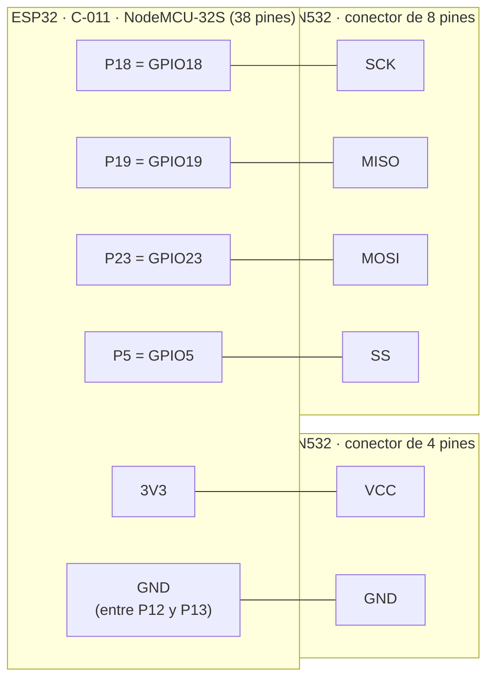

# Conexiones físicas — ESP32 (C-011) ↔ PN532 (C-010)

- **Fecha:** 2026-11-25
- **Estado:** ✅ **SPI, verificado**: firmware completo funcionando con la app real.
- **Decisión de fondo:** [ADR-0003 — SPI](../1-decisiones/ADR-0003-spi-para-el-pn532.md)
  (reemplaza al [ADR-0001 — I2C](../1-decisiones/ADR-0001-i2c-para-el-pn532.md))

---

## Qué es SPI (en 30 segundos)

Una conversación cara a cara con reglas estrictas, con **4 cables de datos**:

- **SCK** (reloj): marca el ritmo. Lo genera **siempre el ESP32**; el PN532 no
  puede retenerlo, que era lo que lo colgaba en I2C.
- **MOSI** (*Master Out, Slave In*): datos del ESP32 hacia el PN532.
- **MISO** (*Master In, Slave Out*): datos del PN532 hacia el ESP32.
- **SS** (*Slave Select*): como tocarle el hombro, "te estoy hablando a ti".

El PN532 además habla con el bit menos significativo primero (LSB first) y en
"modo 0". La librería ya lo sabe; la prueba 06 lo comprobó.

---

## El cableado



| Cable | Del PN532 | Al ESP32 | Por qué ese pin |
|---|---|---|---|
| Alimentación | `VCC` (conector de 4) | `3V3` | Todo a 3,3 V, el idioma del ESP32 |
| Tierra | `GND` (conector de 4) | `GND` entre P12 y P13 | Cualquier `GND` vale: son el mismo punto |
| Reloj | `SCK` | `P18` | SCK por defecto del bus VSPI |
| Datos → ESP32 | `MISO` | `P19` | MISO por defecto del bus VSPI |
| Datos → PN532 | `MOSI` | `P23` | MOSI por defecto del bus VSPI |
| Selección | `SS` | `P5` | SS por defecto del bus VSPI |

**Sin conectar, a propósito:** `SCL` y `SDA` (son del modo I2C), y `IRQ` y
`RSTO` (la librería pregunta por el propio bus si ya hay respuesta).

En la columna derecha del ESP32, desde el extremo de la antena:

```
GND · P23 · P22 · TX · RX · P21 · GND · P19 · P18 · P5 · ...
       ↑                               ↑     ↑     ↑
      MOSI                           MISO   SCK   SS
```

⚠️ **`TX` y `RX` no se usan nunca:** son del USB. Un cable ahí rompe la carga de
programas y el monitor serie.

### ⚠️ Lo que no hay que cambiar

- ⚠️ **`VCC` siempre a `3V3`, nunca a `5V`/`VIN`.** Los pines del ESP32 son de
  3,3 V y no toleran 5 V.
- ⚠️ **Desconecta el USB antes de recablear.**

---

## El interruptor DIP

Está **junto al conector de 4 pines**, y es diminuto: lleva `ON KE` arriba y
`1 2` abajo. Palanca hacia `ON` = 1.

| Modo | Palanca 1 | Palanca 2 |
|---|---|---|
| HSU (UART) | OFF | OFF |
| I2C | ON | OFF |
| **SPI ← el nuestro** | **OFF** (abajo) | **ON** (arriba) |

⚠️ **Muévelo solo sin corriente.** El PN532 lo lee **únicamente al encender**.
Pasar a SPI sin moverlo lo dejó mudo (todo `FF`) durante las pruebas 05 y 06.

---

## Historia: de I2C a SPI

1. **I2C con SCL en P19.** Así venía, siguiendo una especificación de otro
   agente. Contestaba en `0x24`.
2. **SCL movido a P22**, el pin por defecto. Verificado (prueba 01).
3. **El PN532 se colgaba por I2C** en cuanto se le pedía algo más que su
   versión, y retenía SCL en BAJO (pruebas 03 y 04). → [ADR-0003](../1-decisiones/ADR-0003-spi-para-el-pn532.md)
4. **Recableado a SPI.** Mudo hasta que se movió el DIP (pruebas 05 y 06).
   Después funcionó todo a la primera.
